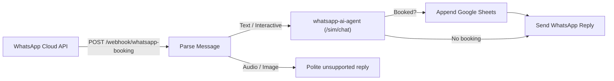

# n8n + WhatsApp Automation Workflows

Production-style **n8n** workflow templates that connect **Meta's WhatsApp Cloud API**, my Python [whatsapp-ai-agent](https://github.com/andresnv22/whatsapp-ai-agent), **Google Sheets**, and **Telegram** team escalations.

*(¿Español? Abajo hay un resumen en español.)*

## Workflows included

| File | Trigger | What it automates |
|---|---|---|
| `workflows/01-whatsapp-ai-booking-router.json` | Webhook (`GET`/`POST`) | Meta verification challenge, text vs. media routing, AI booking agent call, Google Sheets booking log, WhatsApp reply |
| `workflows/02-appointment-reminder-24h.json` | Hourly Schedule | Fetches upcoming confirmed bookings from `GET /appointments` (`Bearer ADMIN_TOKEN`), filters the 24h window, sends WhatsApp template reminders |
| `workflows/03-human-handoff-escalation.json` | Webhook (`POST`) | Classifies escalation priority (`HIGH` / `NORMAL`), alerts the team on Telegram, acknowledges the customer on WhatsApp |

### Booking router architecture



## Run n8n locally in 1 minute

```bash
git clone https://github.com/andresnv22/n8n-whatsapp-workflows
cd n8n-whatsapp-workflows
cp .env.example .env    # fill in your tokens and WHATSAPP_AGENT_URL
docker compose up -d
```

1. Open http://localhost:5678
2. In n8n, choose **Workflows → Import from File** and import the JSON files from `workflows/`.
3. Configure your Google Sheets and Telegram credentials in n8n and activate the workflows.

## Validate workflows (CI & local tests)

Every workflow JSON is automatically validated against schema rules, connection integrity, unique node IDs, and secret leaks:

```bash
uv sync
uv run pytest -v
```

## Resumen en español

Colección de flujos exportados de **n8n** listos para importar, diseñados para trabajar junto a [whatsapp-ai-agent](https://github.com/andresnv22/whatsapp-ai-agent):

1. **Router de reservas por WhatsApp + Google Sheets:** verifica el webhook de Meta, filtra mensajes de texto vs. multimedia, consulta al agente de IA, registra reservas confirmadas en Sheets y responde por WhatsApp.
2. **Recordatorios automáticos 24 h antes:** cron cada hora que consulta `GET /appointments` y envía plantilla de recordatorio por WhatsApp.
3. **Escalamiento a humano:** webhook que clasifica prioridad, avisa al equipo por Telegram y confirma al cliente por WhatsApp.

---

Built by [Andrés Nuñez](https://github.com/andresnv22).
